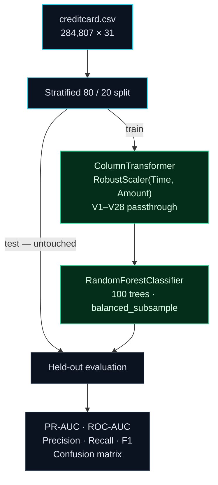
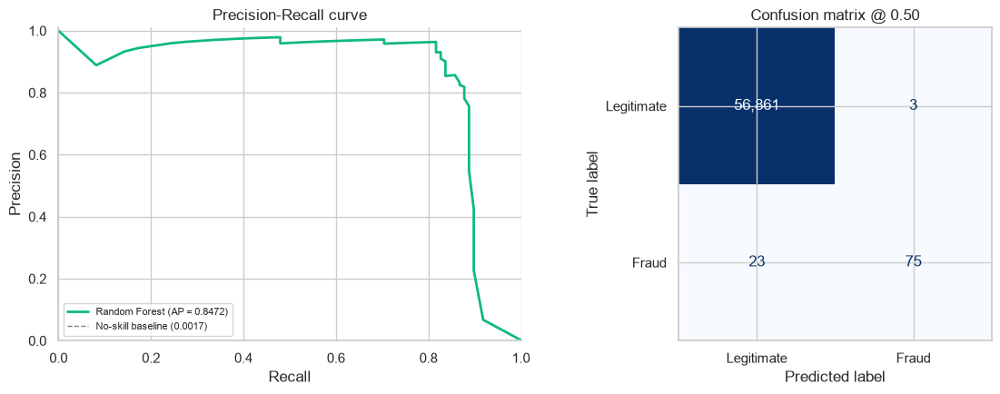

<div align="center">
  
  <br><br>
  <h2>0.17% of transactions. One model. Zero leakage.</h2>
  <p>
    A deliberately small fraud detection pipeline: robust preprocessing and a
    class-balanced Random Forest, evaluated on a held-out split.
  </p>
  <p>
    
    
    
    
    
  </p>
  <p>
    <a href="credit_card_fraud_detection.ipynb"></a>
    <a href="https://colab.research.google.com/github/aryanmendpara/credit-card-fraud-detection/blob/main/credit_card_fraud_detection.ipynb"></a>
    <a href="https://www.kaggle.com/datasets/mlg-ulb/creditcardfraud"></a>
  </p>
</div>

---

> **The point:** predicting “legitimate” for everything scores 99.83% accuracy and catches zero fraud.
>
> This pipeline keeps only what matters — **preprocessing and the model** — and evaluates it with metrics that actually reflect the fraud class.

## The data

The public Kaggle dataset contains **284,807** European card transactions and **492** frauds — a **0.1727%** positive rate. Features `V1`–`V28` are PCA components; `Time` and `Amount` are raw.

| Transactions | Fraud cases | Prevalence | Imbalance |
|---:|---:|---:|---:|
| 284,807 | 492 | 0.1727% | ≈ 578 : 1 |

The notebook requires `creditcard.csv` in the project root. Download it from [Kaggle](https://www.kaggle.com/datasets/mlg-ulb/creditcardfraud) before running.

## The pipeline



That is the whole architecture:

```python
preprocessor = ColumnTransformer(
    transformers=[("robust", RobustScaler(), ["Time", "Amount"])],
    remainder="passthrough",
    verbose_feature_names_out=False,
)

model = Pipeline(
    steps=[
        ("preprocess", preprocessor),
        (
            "classifier",
            RandomForestClassifier(
                n_estimators=100,
                class_weight="balanced_subsample",
                random_state=42,
                n_jobs=-1,
            ),
        ),
    ]
)
```

- **`RobustScaler` only on `Time` and `Amount`.** Median/IQR scaling is resistant to the extreme transaction values; `V1`–`V28` are already PCA-transformed.
- **`class_weight="balanced_subsample"`.** Each bootstrap sample is re-weighted so the rare fraud class is not ignored.
- **Everything is inside one `Pipeline`.** The scaler is fitted on the training fold only; the test set is never transformed during fitting.
- **No SMOTE, no model zoo, no threshold tuning.** The class weighting handles imbalance inside the model.

## Results

| Model | PR-AUC | ROC-AUC | Precision @ 0.5 | Recall @ 0.5 | F1 @ 0.5 |
|---|:---:|:---:|:---:|:---:|:---:|
| **Random Forest** | **0.8472** | **0.9580** | **0.9615** | **0.7653** | **0.8523** |

At the default `0.5` cutoff, the model catches **75 of 98 frauds** with **3 false alerts** on the 56,962-transaction test split.

<p align="center">
  
  <br>
  <sub>Left: PR curve against the 0.17% no-skill baseline. Right: confusion matrix at the default threshold.</sub>
</p>

Accuracy is deliberately omitted: at this prevalence, a model that never predicts fraud would be 99.83% “accurate”.

## Quickstart

```bash
git clone https://github.com/aryanmendpara/credit-card-fraud-detection.git
cd credit-card-fraud-detection

python -m venv .venv
source .venv/bin/activate
pip install -r requirements.txt

jupyter lab credit_card_fraud_detection.ipynb
```

Then choose **Kernel → Restart & Run All**.

Download [`creditcard.csv`](https://www.kaggle.com/datasets/mlg-ulb/creditcardfraud) and place it in the project root to use the real data. The 150 MB CSV is intentionally gitignored.

## Project structure

```
.
├── credit_card_fraud_detection.ipynb   # preprocessing + model + evaluation
├── assets/
│   ├── banner.svg
│   └── model-evaluation.png
├── requirements.txt
├── .gitignore
└── README.md
```

## Design notes

- **Split before fitting.** Stratification preserves the fraud rate and keeps the test set out of every fit call.
- **One model.** The Random Forest is the selected model; no baseline comparison is retained.
- **PR-AUC over accuracy.** It measures ranking quality on the fraud class instead of rewarding the majority class.
- **Default `0.5` threshold.** If precision/recall needs to shift later, tune the threshold against real cost assumptions — not in this minimal baseline.

**Limitations:** the split is random rather than time-based, and the threshold is the default.

---

<div align="center">
  <p>
    <strong>Built with</strong> Python · pandas · NumPy · scikit-learn · Matplotlib · Seaborn
  </p>
  <p>
    Dataset: <a href="https://www.kaggle.com/datasets/mlg-ulb/creditcardfraud">Credit Card Fraud Detection</a> by the Machine Learning Group, Université Libre de Bruxelles.
  </p>
</div>
