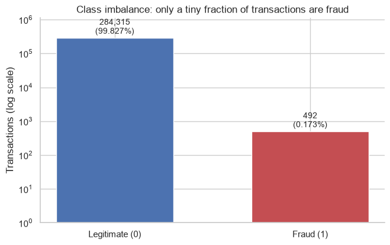
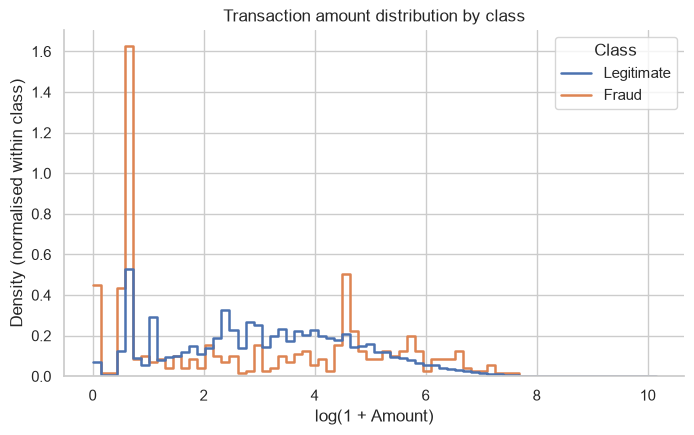
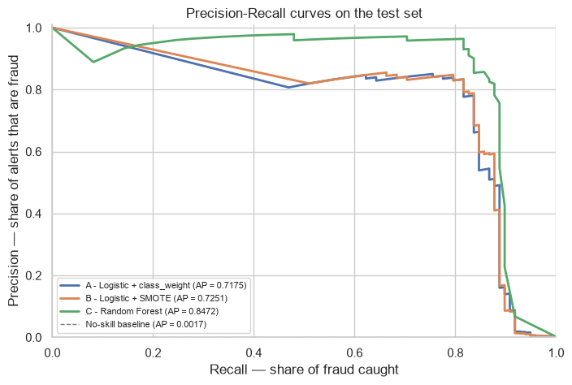
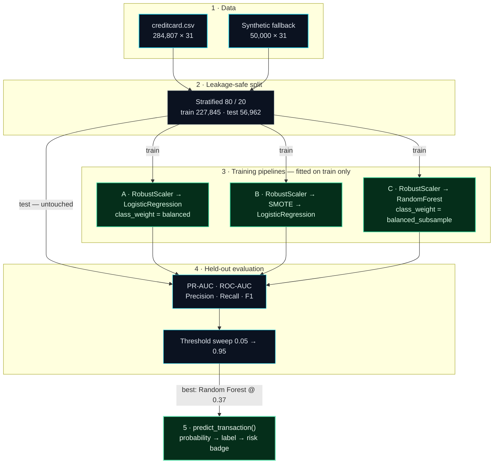
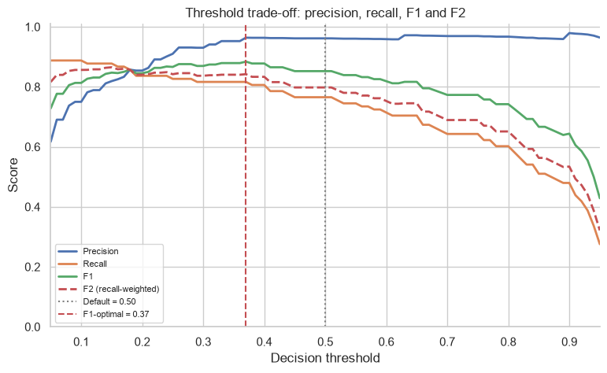
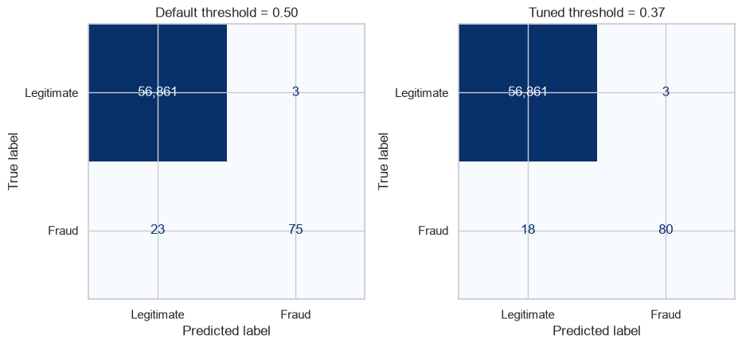
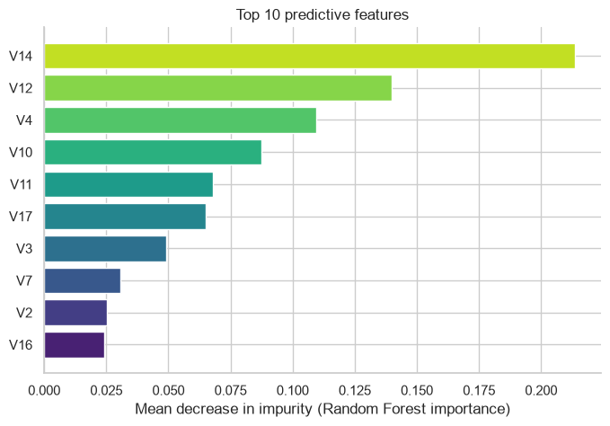

<div align="center">
  
  <br><br>
  <h2>0.17% of transactions. 100% of the problem.</h2>
  <p>
    A single, reproducible Jupyter notebook that takes raw card transactions through
    leakage-safe training, model comparison, threshold tuning, and risk-scored inference.
  </p>
  <p>
    
    
    
    
    
  </p>
  <p>
    <a href="credit_card_fraud_detection.ipynb"></a>
    <a href="https://colab.research.google.com/github/aryanmendpara/credit-card-fraud-detection/blob/main/credit_card_fraud_detection.ipynb"></a>
    <a href="https://www.kaggle.com/datasets/mlg-ulb/creditcardfraud"></a>
  </p>
</div>

---

> **The trap:** predicting “legitimate” for every transaction scores **99.83% accuracy** and catches **zero fraud**.
>
> This project optimises for the fraud class instead: **PR-AUC**, **recall**, and a decision threshold chosen for the business problem.

## The challenge

Credit card fraud detection is a needle-in-a-haystack problem. The public Kaggle dataset contains **284,807** European card transactions from two days in September 2013, and only **492** of them are fraudulent.

| | |
|---|---|
| **Transactions** | 284,807 |
| **Fraud cases** | 492 |
| **Fraud prevalence** | 0.1727% |
| **Imbalance ratio** | ≈ 578 : 1 |
| **Model features** | `V1`–`V28` (PCA) + `Time` + `Amount` |

<table>
  <tr>
    <td width="50%"></td>
    <td width="50%"></td>
  </tr>
  <tr>
    <td align="center"><sub>Accuracy is useless here — the fraud bar is invisible without a log scale.</sub></td>
    <td align="center"><sub>Amounts are heavy-tailed; <code>RobustScaler</code> prevents whale transactions from dominating.</sub></td>
  </tr>
</table>

## Results

> **Random Forest wins on PR-AUC (0.8472).** Moving the threshold from `0.50` to `0.37` catches **5 more frauds** and raises F1 from **0.8523 → 0.8840** — with **no extra false alerts** on this test split.

| Model | Imbalance strategy | PR-AUC | ROC-AUC | Precision @ 0.5 | Recall @ 0.5 | F1 @ 0.5 |
|---|---|:---:|:---:|:---:|:---:|:---:|
| A · Logistic Regression | `class_weight="balanced"` | 0.7175 | **0.9720** | 0.0609 | **0.9184** | 0.1142 |
| B · Logistic Regression | SMOTE oversampling | 0.7251 | 0.9712 | 0.0589 | **0.9184** | 0.1106 |
| **C · Random Forest** | `class_weight="balanced_subsample"` | **0.8472** | 0.9580 | **0.9615** | 0.7653 | **0.8523** |

<p align="center">
  
  <br>
  <sub>PR curves on the untouched test set. The dashed line is the no-skill baseline at 0.17% prevalence.</sub>
</p>

**Why PR-AUC?** The logistic models have slightly higher ROC-AUC, but at the default threshold they flag so many legitimate transactions that only ~6% of alerts are real fraud. PR-AUC exposes that; accuracy and ROC-AUC hide it.

## Architecture



**The core idea:** the train/test split happens **first**. Every scaler, resampler, and classifier is fitted inside the training pipeline. The test set is only scored — never transformed or resampled.

| Layer | Implementation |
|---|---|
| **Data** | Real Kaggle CSV when present; otherwise an automatic synthetic fallback with the same 31-column schema and ~0.2% fraud. |
| **Split** | Stratified 80/20 split so both partitions preserve the fraud rate. |
| **Preprocessing** | `ColumnTransformer` applies `RobustScaler` to `Time` and `Amount`; `V1`–`V28` pass through unchanged. |
| **Pipelines** | `imblearn.pipeline.Pipeline` keeps scaling and SMOTE inside the training fold. Pipeline B fits SMOTE **after** the split. |
| **Evaluation** | PR-AUC, ROC-AUC, precision, recall, F1, confusion matrices — never raw accuracy. |
| **Decision layer** | Threshold sweep from `0.05` to `0.95`; F1 optimum selected, F2 optimum reported as a recall-first alternative. |
| **Inference** | `predict_transaction(pipeline, transaction_dict, threshold)` returns probability, label, and `LOW` / `MEDIUM` / `HIGH`. |

## The 0.5 default is a choice — not a law

`0.5` is inherited from balanced classification. Fraud has asymmetric costs: a **false negative** is an approved fraudulent charge, while a **false positive** is a declined legitimate customer.

<p align="center">
  
  <br>
  <sub>Same model, same test set — only the cutoff changes. F2 weights recall twice as heavily as precision.</sub>
</p>

| Metric | Default `0.50` | Tuned `0.37` | Change |
|---|:---:|:---:|:---:|
| Precision (fraud) | 0.9615 | **0.9639** | +0.0024 |
| Recall (fraud) | 0.7653 | **0.8163** | +0.0510 |
| F1 (fraud) | 0.8523 | **0.8840** | +0.0317 |
| Fraud caught | 75 / 98 | **80 / 98** | **+5** |
| Fraud missed | 23 | **18** | **−5** |
| False alerts | 3 | 3 | 0 |

<p align="center">
  
  <br>
  <sub>Five additional frauds caught with no additional false positives on this held-out split.</sub>
</p>

If catching fraud matters more than avoiding false declines, the notebook also reports the **F2-optimal threshold of 0.15**: precision `0.8190`, recall `0.8776`, F1 `0.8473`.

## What the model looks at

<p align="center">
  
  <br>
  <sub>Top drivers are dominated by <code>V14</code>, <code>V12</code>, <code>V4</code>, <code>V10</code>, and <code>V11</code>.</sub>
</p>

These are impurity-based Random Forest importances. They show **which signals the ensemble relies on**, not direction or causality. For a fraud team they are monitoring targets: a sudden shift in the top drivers is an early signal of behavioural drift.

## Inference in one call

```python
result = predict_transaction(
    best_pipeline,
    transaction_dict,        # Time, V1–V28, Amount
    threshold=BEST_THRESHOLD # 0.37
)

# {'fraud_probability': 0.92, 'predicted_label': 1, 'risk_badge': 'HIGH'}
```

| Scenario | Amount | Fraud probability | Label | Risk badge |
|---|---:|:---:|:---:|:---:|
| Typical legitimate transaction | $23.00 | 0.000000 | `0` | `LOW` |
| Suspicious high-risk transaction | $512.25 | 0.920000 | `1` | `HIGH` |

Badge bands are anchored to the tuned threshold: `HIGH` means probability ≥ threshold (a real alert), `MEDIUM` means ≥ half the threshold, and `LOW` is below that. The function validates that all 30 required features are present before scoring.

## Quickstart

```bash
git clone https://github.com/aryanmendpara/credit-card-fraud-detection.git
cd credit-card-fraud-detection

python -m venv .venv
source .venv/bin/activate
pip install -r requirements.txt

jupyter lab credit_card_fraud_detection.ipynb
```

Then choose **Kernel → Restart & Run All**.

**Dataset:** download [`creditcard.csv`](https://www.kaggle.com/datasets/mlg-ulb/creditcardfraud) and place it in the project root. If it is missing, the notebook generates a **50,000-row synthetic fallback** with the same schema and ~0.23% fraud, so every cell still runs. The fallback was executed end-to-end separately with zero errors.

## Project structure

```
.
├── credit_card_fraud_detection.ipynb   # the entire pipeline, executed
├── assets/
│   ├── banner.svg                      # README hero
│   ├── class-imbalance.png
│   ├── amount-distribution.png
│   ├── pr-curves.png
│   ├── threshold-tradeoff.png
│   ├── threshold-confusion-matrices.png
│   └── feature-importance.png
├── requirements.txt
├── .gitignore
└── README.md
```

`creditcard.csv` is intentionally **not committed** — it is ~150 MB. The `.gitignore` keeps it out.

## Design decisions

| Decision | Why |
|---|---|
| **Stratified split before anything else** | Preserves the 0.17% fraud rate and guarantees the test set is untouched. |
| **`RobustScaler` for `Time` and `Amount`** | Median/IQR scaling is resistant to the extreme transaction values visible in the EDA. |
| **SMOTE inside an `imblearn` pipeline** | Synthetic frauds are generated only from the training fold — no leakage into evaluation. |
| **PR-AUC as the headline metric** | It focuses on the fraud class; ROC-AUC can look strong even when precision is unusable. |
| **Threshold sweep after training** | The model outputs probabilities; the business decides where to place the alert line. |
| **Three imbalance strategies** | Class weighting, SMOTE, and balanced subsampling are compared empirically, not assumed. |
| **No accuracy** | At 0.17% prevalence, accuracy is a vanity metric. |

## Honest limitations

- **Random split, not a time-based split.** Real deployment scores future transactions. A temporal holdout would better simulate drift.
- **Threshold tuned on the evaluation set.** This is standard for a demo, but production should tune on a separate validation window or out-of-time sample.
- **Probability calibration is not applied.** Probabilities are useful for ranking; turning them into literal risk/cost estimates needs isotonic or sigmoid calibration.
- **Tree importance is not causal.** It is a monitoring signal, not an explanation of why a specific transaction was flagged.
- **The synthetic fallback is a demo.** Results from it are not comparable to the Kaggle benchmark.

**Next steps:** cost-sensitive thresholding using chargeback and false-decline costs, time-based validation, probability calibration, SHAP explanations, and drift monitoring for the top features.

---

<div align="center">
  <p>
    <strong>Built with</strong> Python · pandas · NumPy · scikit-learn · imbalanced-learn · Matplotlib · Seaborn
  </p>
  <p>
    Dataset: <a href="https://www.kaggle.com/datasets/mlg-ulb/creditcardfraud">Credit Card Fraud Detection</a> by the Machine Learning Group, Université Libre de Bruxelles.
  </p>
  <p><sub>If this notebook helped you think clearly about imbalance, leakage, or thresholds, a ⭐ is appreciated.</sub></p>
</div>
